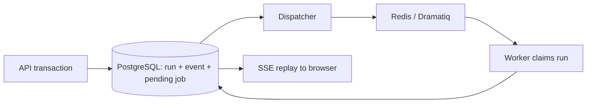

# DeployFlow backend — Phase 3

FastAPI API, PostgreSQL state and event history, Redis/Dramatiq workers, and a
database-backed job dispatcher. Analysis resolves a GitHub revision through a
configured GitHub App and runs deterministic, read-only repository scanners.
An explicitly enabled agent mode can use DeepSeek with reviewed skills and a
bounded, read-only repository MCP server. It never executes repository code,
creates a GitHub PR, or contacts Kubernetes.

Installation-token requests retry transient GitHub `422`, `429`, and `5xx` responses with bounded
backoff. Permanent failures retain a short sanitized GitHub diagnostic in the failed event; tokens,
private keys, and source contents are never returned.

## GitHub App configuration

Set `DF_GITHUB_APP_ID`, `DF_GITHUB_INSTALLATION_ID`, and
`DF_GITHUB_PRIVATE_KEY_PATH` for an installed App with repository contents-read
permission. Keep the PEM outside this repository. Without these values, analysis
runs fail with `github_auth_unconfigured`; the test service deliberately uses
the fake provider so durability tests remain independent of GitHub.

## Optional DeepSeek agent mode

`DF_ANALYSIS_MODE=deterministic` is the default and does not call a model. To
explicitly opt in to agent analysis, add the following to the ignored
`backend/.env`, then recreate the worker:

```bash
DF_ANALYSIS_MODE=agent
DF_DEEPSEEK_API_KEY=your-key
DF_DEEPSEEK_MODEL=deepseek-flash
DF_DEEPSEEK_REASONING_EFFORT=high
docker compose up -d --build worker
```

The agent is stateless, uses only the project-owned read-only repository tools,
and records selected skill versions, evidence hashes, tool metadata, model
identity, and aggregate usage. It can finish as `needs_input` when a deployment
decision cannot be derived from the repository. Do not put a real key in
`.env.example`, source code, or Git.

## Start locally

Requirements: Docker with Docker Compose. Host Python is optional; the containers
use Python 3.12 and the committed `uv.lock`.

```bash
cd deploy-flow/backend
docker compose up --build -d
docker compose ps
```

Open [API documentation](http://127.0.0.1:8000/docs).
The API is published on **127.0.0.1:8000**. PostgreSQL and Redis have no host ports.
The migration service runs before the API, dispatcher, and worker start.

The existing `.env` can remain in place. It is ignored by Git and excluded from
the image. `.env.example` documents optional local overrides; don't overwrite
existing settings. Compose passes only its listed `DF_*` variables to the backend.
GHCR and Kubernetes credentials are unnecessary for this phase. GitHub App
credentials are required for deterministic/agent repository analysis; a DeepSeek
key is required only for explicitly selected agent mode.

```bash
docker compose logs -f api dispatcher worker
docker compose stop
docker compose up -d
```

Stopping/restarting preserves the named PostgreSQL and Redis volumes. The local
database password in Compose is for this loopback-only development stack.

## Try one analysis

Create an application (returns `201`):

```bash
curl -s http://127.0.0.1:8000/api/v1/applications \
  -H 'Content-Type: application/json' \
  -H 'Idempotency-Key: fixture-create-1' \
  -d '{"name":"node-express-service","repository_url":"https://github.com/DamiBeGud/deployflow-node-express-fixture","revision":"main"}'
```

Replace `APPLICATION_ID` with the returned `id`. Queue an analysis (returns `202`):

```bash
curl -s http://127.0.0.1:8000/api/v1/applications/APPLICATION_ID/analyses \
  -H 'Content-Type: application/json' \
  -H 'Idempotency-Key: fixture-analysis-1' \
  -d '{}'
```

Repeat that exact command to get the same logical run. Reusing the same key for
a different revision returns `409`. Use a new key to intentionally create a new run.

Replace `RUN_ID` with the returned `run_id`:

```bash
curl -N http://127.0.0.1:8000/api/v1/analyses/RUN_ID/events
curl -s http://127.0.0.1:8000/api/v1/analyses/RUN_ID

# Reconnect after event 3, even after the run has completed:
curl -N http://127.0.0.1:8000/api/v1/analyses/RUN_ID/events \
  -H 'Last-Event-ID: 3'

# Cancel a queued/running analysis:
curl -s -X POST http://127.0.0.1:8000/api/v1/analyses/RUN_ID/cancel \
  -H 'Idempotency-Key: cancel-1'

# Correct the result without overwriting the original assessment:
curl -s -X PATCH http://127.0.0.1:8000/api/v1/analyses/RUN_ID/assessment \
  -H 'Content-Type: application/json' -H 'Idempotency-Key: review-1' \
  -d '{"expected_version":1,"port":8080}'
```

Available Phase 1 routes:

| Method | Path under `/api/v1` | Behavior |
| --- | --- | --- |
| GET | `/me` | Configured development identity |
| POST / GET | `/applications` | Create / list owned applications |
| GET | `/applications/{id}` | Application and latest run |
| POST | `/applications/{id}/analyses` | Queue repository analysis |
| GET | `/analyses/{id}` | Durable status and current assessment |
| GET | `/analyses/{id}/events` | SSE replay/live progress |
| PATCH | `/analyses/{id}/assessment` | New assessment version; optimistic concurrency |
| POST | `/analyses/{id}/reanalyze` | New independent run |
| POST | `/analyses/{id}/cancel` | Cancel queued/running work |

All mutations require `Idempotency-Key`. Keys are scoped to organization, actor,
and action (including target ID), with a canonical hash of validated request data.
Responses carry `X-Correlation-ID`; callers may supply a safe ID. Errors use
`application/problem+json` and never echo request values or exception details.

## Frontend contract

The frontend in `../frontend` now consumes all Phase 1 application/analysis routes.
Run `npm run dev` there and open `http://127.0.0.1:5174`. Vite proxies `/api` to this
backend on port 8000, including SSE. The browser uses the same origin, so CORS
changes are unnecessary. For clients that call the backend directly, CORS permits
`http://localhost:5173` and `http://127.0.0.1:5173` by default; override
`DF_CORS_ORIGINS` with a JSON array if required.

## Editor changes and Docker hot reload

```bash
docker compose up --build -d
docker compose watch --no-up api worker dispatcher
```

Keep the second command running. Compose Watch syncs `app/` edits into all three
Python services and restarts their processes. This requires Compose 2.32+ for
`initial_sync`; the local Docker Compose version is compatible. The application
source in the image is owned by its non-root runtime user so synchronization works.
PostgreSQL/Redis and their volumes are unaffected. An in-progress job may finish
during graceful shutdown or be recovered by its lease after restart; SSE clients
reconnect and replay saved progress.

`pyproject.toml`, `uv.lock`, or `Dockerfile` edits rebuild images automatically.
Update `uv.lock` along with dependency changes; builds use `uv sync --frozen`.
Compose configuration/environment changes require `docker compose up -d` again.
Migration edits are intentionally not applied by the watcher: rebuild the image,
then explicitly run `docker compose run --rm migrate` before restarting services.
Stopping Watch stops synchronization, not the containers. Use `docker compose stop`
to stop the local stack while preserving data.

Verified locally by changing a Python file and observing synchronization plus new
start times for API, worker, and dispatcher. [Compose Watch documentation](https://docs.docker.com/compose/how-tos/file-watch/)

## Progress stream contract

After creating an application, POST an empty object to its `/analyses` route,
save `run_id`, and open the returned `events_url` with `EventSource`. Listen for
named events (`analysis.queued`, `analysis.started`, `analysis.scanning`,
`analysis.agent_running`, `analysis.validating`, `analysis.retrying`,
`analysis.completed`, `analysis.needs_input`, `analysis.failed`, `analysis.cancelled`). On a terminal
event call `EventSource.close()` and GET the run for its final result.

Event IDs are positive integers **scoped to a run**, serialized under a run row
lock. EventSource automatically sends `Last-Event-ID` when it reconnects;
`?after=N` also supports a fresh connection after a page reload. SSE sends
heartbeats while idle and closes after all available terminal-run events have
been replayed. No database connection is held while waiting for the next poll.
Completed events remain available after Redis or API restarts.

## Durability and recovery



- State changes and pending jobs commit in one transaction. A uniqueness
  constraint serializes concurrent idempotency keys in PostgreSQL.
- The dispatcher republishes unclaimed runs every 10 seconds. Publishing before
  committing can deliver duplicates; workers atomically claim the run by ID.
- A worker owns a random lease token for up to five minutes. Every checkpoint and
  completion checks that token, status, and deadline. An expired worker cannot
  write over a recovered run. Future external operations also need their own
  idempotency/fencing; this foundation currently performs database-only work.
- The dispatcher recovers expired leases, with up to three total attempts and
  bounded backoff. Runs also have a one-hour overall queue deadline. Dramatiq
  retries are disabled because retry decisions live in PostgreSQL.
- Cancellation immediately records a terminal state and invalidates the lease.
  The fake worker notices it at the next checkpoint (normally within one second).
- Assessment versions and progress events are append-only through the API.
  Idempotency records and event history are retained without automatic expiry.

The dispatcher must be running for job recovery. `GET /health/ready` checks the
database/migration table; it deliberately remains ready when Redis is unavailable,
so queued work can still be accepted durably. Monitor dispatcher and worker logs
when queued runs are not progressing.

## Identity boundary

`IdentityProvider` is the interface for future authentication. The current provider
uses a single server-configured development identity. It ignores caller-supplied
actor/role headers. All resource reads and mutations enforce organization and
ownership; administrators may access other owners in their own organization.
Viewer identities can read, while developer/deployer/administrator roles can
mutate. This local provider has **no login or token verification**. Configuring
`DF_ENVIRONMENT=production` refuses startup until real authentication is implemented.
Do not publish or tunnel this development API.

## Verification

```bash
# PostgreSQL-backed tests, with an isolated deployflow_test database:
docker compose run --rm tests

# Real API -> dispatcher -> broker -> worker -> SSE journey:
python3 scripts/smoke.py

# Explicitly opt in first with DF_ANALYSIS_MODE=agent and a DeepSeek key, then
# verify the model-backed path (this may consume API credit):
python3 scripts/smoke.py --agent

# Also SIGKILL this local Compose worker mid-run, restart it, wait for
# lease recovery, restart this local Redis, and verify SSE replay:
python3 scripts/smoke.py --recovery

# Formatting / static checks in the built image:
docker compose run --rm --no-deps api ruff check app tests scripts migrations
docker compose run --rm --no-deps api ruff format --check app tests scripts migrations
docker compose run --rm --no-deps migrate alembic check
```

The recovery smoke test restarts only the `worker` and `redis` services in this
directory's Compose project and leaves its generated smoke application/run in the
development database. It requires the default nonzero fake analysis delay.
The pytest suite refuses database cleanup unless the database is exactly
`deployflow_test`. Tests cover duplicate requests/deliveries, rollback, lease
fencing, bounded retries/timeouts, Redis delivery loss, cancellation, immutable
assessment revisions, ownership/roles, and ordered SSE replay.

Implementation references: [Dramatiq guide](https://dramatiq.io/guide.html) and
[Dramatiq Redis broker reference](https://dramatiq.io/reference.html).
