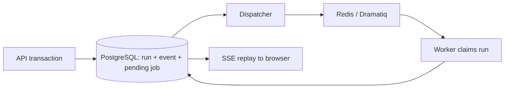

# DeployFlow backend — analysis, reviewed PRs, and CI verification

FastAPI API, PostgreSQL state and event history, Redis/Dramatiq workers, and a
database-backed job dispatcher. Analysis resolves a GitHub revision through a
configured GitHub App and runs deterministic, read-only repository scanners.
An explicitly enabled agent mode can use DeepSeek with reviewed skills and a
bounded, read-only repository MCP server. Phase 4 stores versioned delivery
intent and generates a reviewable Dockerfile/workflow/Kubernetes bundle. Phase 5
checks Kubernetes admission with server-side dry-run. Phase 6 queues one GitHub
infrastructure PR after review and verifies the merged CI image digest. None of
these phases applies resources to Kubernetes; deployment is Phase 7.

The Kubernetes recommendation endpoint combines repository evidence with the fixed
local Kubernetes policy to return one complete editable intent. It does not ask the
user deployment questions or query a live cluster; resource and exposure defaults
are explicitly labelled as policy defaults.

The Node generator (`node-web-v4`) declares `USER 1000:1000` in generated
application images, while keeping Kubernetes `runAsNonRoot: true`. Each image
build checks that its base image's `node` account really has UID/GID 1000;
incompatible custom bases fail the build instead of silently choosing another
identity. A named `USER node` alone is insufficient for Kubernetes to verify
nonroot execution. Older generated plans must be regenerated and reviewed;
existing approved bundles and releases are never rewritten. Fixing an already
deployed old image requires a newly reviewed bundle, PR/CI image, and authorized
release, not just rebuilding the DeployFlow backend or restarting the old Pod.

## k3s readiness (pre-Phase 5)

The local profile now matches the existing cluster's `nginx` IngressClass and
`deployflow-test` namespace. See the [sanitized P0-01 readiness record](ops/k3s/P0-01-readiness.md)
for verified access boundaries and outstanding work. To repeat its read-only
checks from the repository root:

```bash
DF_K3S_SSH_TARGET=user@host bash backend/scripts/check_k3s_readiness.sh
```

For local development, `backend/scripts/k3s_tunnel.sh` can forward the API to
`https://127.0.0.1:16443` over SSH. Set `DF_K3S_SSH_TARGET`; optionally set
`DF_K3S_SSH_KEY` and `DF_K3S_LOCAL_PORT`. The tunnel alone is not an authenticated
Kubernetes client: separate short-lived reader and validator tokens and a
trusted CA are required, and must stay outside Git. Phase 5 adds opt-in reader
and validator MCP processes; the analysis worker receives neither credential.
The dashboard is limited to `deployflow-test`. Manifest validation accepts
only a stored bundle and uses server-side dry-run; it cannot deploy resources.
Regenerate old plans after the template/profile change; older plans are stale
and cannot be approved or sent to GitHub.

The `phase5` Compose profile is off by default. After separately approving the
exact server actions, provide absolute paths outside this repository for a
dedicated SSH key, pinned `known_hosts`, Kubernetes CA, and separate short-lived
ServiceAccount token files. Set `DF_K3S_SSH_TARGET`, `DF_K3S_SSH_KEY_PATH`,
`DF_K3S_KNOWN_HOSTS_PATH`, `DF_KUBE_CA_PATH`, `DF_KUBE_READER_TOKEN_PATH`, and
`DF_KUBE_VALIDATOR_TOKEN_PATH`. Set
`DF_KUBE_READER_MCP_URL=http://kube-reader-tunnel:8001/mcp` and
`DF_KUBE_VALIDATOR_MCP_URL=http://kube-validator-tunnel:8001/mcp`, then start
with `docker compose --profile phase5 up -d --build`. No Kubernetes credential
is mounted into the API, dispatcher, or analysis worker. Expired tokens must
be replaced and the respective MCP process restarted; there is no admin-token
fallback. The tunnel and MCP entrypoints copy `0600` host credentials into
private container tmpfs and drop to UID 10001 before serving requests. Do not
start this profile with `/dev/null` placeholder paths.

### Renew Phase 5 access tokens

The reader and validator use short-lived ServiceAccount tokens. If the UI
reports `cluster_access_expired`, renew both local token files, then restart
only the local MCP containers. The following assumes the configured target is
`connectops@host` and the default local credential directory; adjust the SSH
target, key, and token paths to match the values in your ignored `.env`.

```bash
mkdir -p ~/.config/deployflow/phase5
chmod 700 ~/.config/deployflow/phase5

ssh -i ~/.ssh/id_ed25519 connectops@host \
  'sudo k3s kubectl -n deployflow-test create token deployflow-validator --duration=24h' \
  > ~/.config/deployflow/phase5/validator.token

ssh -i ~/.ssh/id_ed25519 connectops@host \
  'sudo k3s kubectl -n deployflow-test create token deployflow-reader --duration=24h' \
  > ~/.config/deployflow/phase5/reader.token

chmod 600 ~/.config/deployflow/phase5/validator.token \
  ~/.config/deployflow/phase5/reader.token

docker compose --profile phase5 restart kube-reader kube-validator
```

Token creation does not modify workloads, Pods, Deployments, Services,
namespaces, RBAC, or application data. It creates temporary authentication
credentials for the already-provisioned ServiceAccounts; in the example above
they expire after 24 hours. The local restart only reloads the new token files.

Installation-token requests retry transient GitHub `422`, `429`, and `5xx` responses with bounded
backoff. Permanent failures retain a short sanitized GitHub diagnostic in the failed event; tokens,
private keys, and source contents are never returned.

## GitHub App configuration

Set `DF_GITHUB_APP_ID`, `DF_GITHUB_INSTALLATION_ID`, and
`DF_GITHUB_PRIVATE_KEY_PATH` for an installed App. Keep the PEM outside this
repository. Analysis requests only a repository-scoped contents-read token;
the separate `github-worker` requests contents-write, pull-requests-write,
workflows-write, and actions-read for its repository. Update the App's
permissions and approve the installation update before trying the Phase 6 PR
action. Configure signed `pull_request` and `workflow_run` webhook events and
set the same high-entropy secret as `DF_GITHUB_WEBHOOK_SECRET` in the ignored
`.env` and GitHub App settings. Missing permissions or credentials block PR
creation; they do not fall back to a personal token.

The `webhook` Compose service serves **only** `/webhooks/github` on local port
`8002` (override with `WEBHOOK_PORT`). GitHub needs an HTTPS-reachable endpoint
that forwards only to this service. Never expose port `8000` or the development-
identity API through a public tunnel. The receiver verifies HMAC-SHA256 over
the raw request body and stores delivery IDs before queuing reconciliation.
Its process has no GitHub App private key, model key, or Kubernetes credential.

The generated workflow tests pull requests with read-only repository access.
After merge, its push run logs into GHCR using the repository's `GITHUB_TOKEN`,
publishes the image, and uploads `deployflow-build.json`. The backend accepts a
digest only when GitHub reports the expected merged PR, expected workflow and
successful run, exact approved merged files, matching artifact identifiers, and
an existing GHCR manifest at that digest. GHCR packages may initially be
private; make the fixture package public for anonymous verification and later
cluster pulls. No CI job has a Kubernetes credential. Phase 6 stops at a
verified build record and never deploys.

## Phase 7 release preparation and delivery handoff

The internal release-preparation operation binds the verified CI image digest
to the reviewed Deployment, changing no other manifest field. It requires a
still-approved plan, a verified PR/build, and the merge commit to remain the
target branch head. It then runs a fresh server-side dry-run and stores the
exact final Kubernetes manifest bytes and digest. A reverted merge or failed
admission cannot produce a release candidate. A verified CI build records one
durable preparation job. The delivery worker uses that build ID, stores one
release and deployment run, and repeats preflight before reporting
`waiting_for_executor`. The deployment status and ordered events are available
through `/api/v1/deployments/{id}` and `/api/v1/deployments/{id}/events`.

The `phase7-delivery` Compose profile starts only the delivery worker. It needs
the configured GitHub App and the existing Phase 5 validator URL; the worker
joins the validator network but receives no Kubernetes credential. Start the
validator profile first, then use `docker compose --profile phase5 --profile
phase7-delivery up -d --build delivery-worker` after applying the local schema
migration through the normal `migrate` service. Check the PR response's
`release_preparation`, `release`, and `deployment` fields for progress. A build
verified before the delivery worker existed can be scheduled with an
idempotent `POST /api/v1/pull-requests/{id}/release-preparation`; blocked jobs
can use that route again after correction. Preflight failures can be retried
with `POST /api/v1/deployments/{id}/retry-preflight`. These commands require
`Idempotency-Key` and normal application authorization. The delivery worker
has no deployer identity and cannot apply resources.

## Phase 7 guarded execution (opt-in; not provisioned by default)

The [operational closure record](ops/phase7-operational-closure.md) contains the
latest preflight findings, pending migration SQL, and the local backup/restart
proposal. Preview the current Phase 7 upgrade without connecting to a database
using `alembic upgrade 2f73b94e8c16:91d2e0a7b534 --sql` inside the backend image.

### Local-only OIDC sign-in

For local testing, the `local-oidc` Compose profile runs Keycloak in development
mode on **127.0.0.1:8180**. It is not a production identity provider and must
not be exposed publicly. The backend accepts its exact HTTP issuer and internal
JWKS endpoint only when `DF_ENVIRONMENT=local`; any deployed environment still
requires HTTPS. Create its two random passwords outside Git, then start only
the new identity container:

```bash
cd backend
python3 scripts/setup_local_oidc.py
docker compose --profile local-oidc up -d keycloak
curl -fsS http://127.0.0.1:8180/realms/deployflow-local/.well-known/openid-configuration
```

The ignored `.env` needs `DF_LOCAL_OIDC_ENV_FILE` pointing to the generated
`~/.config/deployflow/local-oidc/keycloak.env`, plus these non-secret values:

```dotenv
DF_AUTH_MODE=oidc
DF_OIDC_ISSUER=http://localhost:8180/realms/deployflow-local
DF_OIDC_AUDIENCE=deployflow-api
DF_OIDC_JWKS_URL=http://keycloak:8080/realms/deployflow-local/protocol/openid-connect/certs
DF_OIDC_AUTHORIZATION_ENDPOINT=http://localhost:8180/realms/deployflow-local/protocol/openid-connect/auth
DF_OIDC_TOKEN_ENDPOINT=http://localhost:8180/realms/deployflow-local/protocol/openid-connect/token
DF_OIDC_CLIENT_ID=deployflow-local-ui
```

The browser client is public, requires S256 PKCE, and accepts only the
`/auth/callback` route at local port 5174. The imported user is
`deployflow-local`; its password is `DF_LOCAL_OIDC_USER_PASSWORD` in the private
file. Do not paste this file or its values into issues, logs, or chat. This
user receives `administrator` only in the local DeployFlow realm and
`organization_id=local-organization`, so it can see existing local test apps.
Keycloak imports the realm only when it is first created; editing the import
file later does not overwrite existing users or passwords. OIDC configuration
alone does **not** enable cluster deployment or run database migrations.

The executor can apply the stored, verified release to `deployflow-test` only
after OIDC authorization, an application-specific deployment policy, fresh
GitHub/CI checks, and another server-side admission dry-run. The default
`DF_DEPLOYMENT_EXECUTION_ENABLED=false` prevents queuing; the
`phase7-executor` Compose profile is also off. Existing
`waiting_for_executor` runs are **not** deployed merely by enabling the flag.
A deployer must enable that application's policy and explicitly select
**Deploy this prepared release**. Future verified releases for an enabled
application queue automatically after preflight. The same UI can disable
future automatic deployments.

Execution uses a separate short-lived `deployflow-deployer` ServiceAccount,
SSH tunnel, and one-thread worker. The proposed additive namespace RBAC is
[phase7-deployer-access.yaml](ops/k3s/phase7-deployer-access.yaml). It grants
only `get/create/patch` on ConfigMaps, Services, Deployments, and Ingresses;
`list` on Pods; and `get` on the dedicated health checker's Service proxy. It grants no Secret or delete
access and changes no existing Role or workload. **This manifest is for
operator review only and is not applied by Compose or migrations.** Do not
apply it or create a token until the k3s operator approves those exact changes.
The existing reader and validator identities remain separate. The checker has
a named Service port, so the executor uses the exact proxy name
`deployflow-health-checker:http`; the Role allows only `get` on that same
port-qualified name. Omitting the port can return `503` despite ready endpoints,
and granting only the unqualified name does not authorize the correct request.

Before deployment outside the local profile, configure a real HTTPS OIDC provider for a browser public
client using authorization-code + PKCE. Register the frontend callback
`<frontend-origin>/auth/callback`, allow token-endpoint CORS for that origin,
and issue signed access tokens with this API's audience, `organization_id`,
and a `roles` array. The user needs `deployer` or `administrator` to enable or
execute deployment; application ownership rules still apply. Set
`DF_AUTH_MODE=oidc`, `DF_OIDC_ISSUER`, `DF_OIDC_AUDIENCE`, `DF_OIDC_JWKS_URL`,
`DF_OIDC_AUTHORIZATION_ENDPOINT`, `DF_OIDC_TOKEN_ENDPOINT`, and
`DF_OIDC_CLIENT_ID` in the ignored local `.env`. Production mode refuses
development identity. The current development identity cannot deploy, even
if assigned a deployer role.

The [health checker manifest](ops/k3s/phase7-health-checker.yaml) is also for
operator review only. Before execution is enabled, build and publish the
checker image using [Dockerfile.health-checker](ops/k3s/Dockerfile.health-checker),
which copies only the checker module and locked runtime dependencies. Build for
the target cluster architecture and pin the verified published digest in the manifest,
review its restricted Pod and ClusterIP Service, and obtain separate approval
to add it to `deployflow-test`. It has no Kubernetes API token. Without a
healthy checker, internal health remains pending and deployments cannot be
reported as successful. Do not point the executor directly at application
Services as a fallback.

After separate approval of k3s changes, supply the reviewed ServiceAccount
token in a `0600` host file outside Git and point
`DF_KUBE_DEPLOYER_TOKEN_PATH` to its absolute path. The executor also needs the
existing SSH key, pinned host key, trusted CA, GitHub App key, validator URL,
and database/Redis access. Apply the local database migration, then explicitly
enable `DF_DEPLOYMENT_EXECUTION_ENABLED=true` and start only the executor
profile with `docker compose --profile phase7-executor up -d --build
kube-deployer-tunnel kube-deployer`; recreate the API, delivery worker, and
dispatcher with the same new settings. This is a deployment-enabling action,
so first confirm the OIDC claims and target namespace. Never use the reader or
validator token as the deployer token.

The executor journals each resource before the bounded Kubernetes request,
checks ownership/UIDs on retries, and never forces apply conflicts. After all
resources are journaled as applied, rollout and health retries observe the
existing resources without reapplying them; the execution deadline still bounds
the wait. It waits for the Deployment's observed generation and ready/available
replicas, checks the recorded Deployment generation and Service UID, then
asks the dedicated in-cluster checker to GET the application's ClusterIP
Service through the checker's Service proxy. Releases with an
Ingress also require an HTTP/TLS check by the separate, credential-free
`external-probe` container; it does not follow redirects or return response
bodies. DNS, connection, timeout, and non-2xx responses remain pending until
the execution deadline. The UI displays
deployment ID, resource journal, rollout counts, health, and ordered events.
Partial or ambiguous failures enter `reconciling` without deleting or rolling
back existing resources. An authorized deployer can use **Retry
reconciliation** after investigating and fixing the cause. Newly generated
bundles put a digest of the ConfigMap data on the Pod template, so a
configuration-only change rolls new Pods. Older bundles without a Pod-template
change are rejected instead of falsely reported as a successful rollout.
An authorized deployer can manually roll back the latest successful deployment
only when it has a previous successful release and no active deployment. The
backend creates a **new immutable rollback release** by copying the previous
stored Kubernetes bytes and verified image digest. The isolated executor runs
fresh server-side admission before applying it. No historical GitHub branch
head is required, and rollback does not revert application database data.
The application lifecycle page shows history, rollout and health, resource
inventory, and an explicit rollback review. A failed first deployment has no
rollback target.

For that first-deployment case only, an explicitly enabled cleanup command can
remove the resource journal after the user reviews the exact release digest,
kind, name, and recorded UID. It runs in a **separate cleaner worker** with no
GitHub App key and no create/patch permission. The cleaner rechecks that each
resource belongs to this application and deletes using a live UID
precondition; it waits until absence is observed. Other deployments and
unmanaged resources are never cleanup targets. `DF_DEPLOYMENT_CLEANUP_ENABLED`
defaults to `false`. The additive [cleaner RBAC](ops/k3s/phase7-cleaner-access.yaml)
is for operator review only. It has not been applied to the cluster.

To activate cleanup later, first review and separately approve that RBAC and
the new `deployflow-cleaner` ServiceAccount on k3s. Store a short-lived cleaner
token outside Git at `DF_KUBE_CLEANER_TOKEN_PATH`, then enable the cleanup flag
and start the `phase7-cleanup` Compose profile. The API, dispatcher, and cleaner
must receive the same flag. Do not reuse the deployer token: its Role has no
delete permission, while the cleaner Role has no create/patch permission.
Apply the local schema migrations only after reviewing the database backup and
restart plan. Neither Compose profiles nor migrations apply the RBAC manifests.
Multi-environment support remains later work.

## Optional DeepSeek agent mode

`DF_ANALYSIS_MODE=deterministic` is the default and does not call a model. To
explicitly opt in to agent analysis, add the following to the ignored
`backend/.env`, then recreate the worker:

```bash
DF_ANALYSIS_MODE=agent
DF_DEEPSEEK_API_KEY=your-key
DF_DEEPSEEK_MODEL=deepseek-flash
DF_DEEPSEEK_REASONING_EFFORT=high
docker compose up -d --build worker
```

The agent is stateless, uses only the project-owned read-only repository tools,
and records selected skill versions, evidence hashes, tool metadata, model
identity, and aggregate usage. It can finish as `needs_input` when a deployment
decision cannot be derived from the repository. Do not put a real key in
`.env.example`, source code, or Git.

## Start locally

Requirements: Docker with Docker Compose. Host Python is optional; the containers
use Python 3.12 and the committed `uv.lock`.

```bash
cd deploy-flow/backend
docker compose up --build -d
docker compose ps
```

Open [API documentation](http://127.0.0.1:8000/docs).
The API is published on **127.0.0.1:8000**. PostgreSQL and Redis have no host ports.
The migration service runs before the API, dispatcher, and worker start.

The existing `.env` can remain in place. It is ignored by Git and excluded from
the image. `.env.example` documents optional local overrides; don't overwrite
existing settings. Compose passes only its listed `DF_*` variables to the backend.
GitHub App credentials are required for deterministic/agent repository analysis; a
DeepSeek key is required only for explicitly selected agent mode. Phase 4's local
preview profile also needs `GHCR_REGISTRY` and `GHCR_IMAGE`; these are image names,
not registry credentials. The opt-in Phase 5 MCP processes use scoped Kubernetes
credentials; public GHCR images require no image-pull secret.

```bash
docker compose logs -f api dispatcher worker
docker compose stop
docker compose up -d
```

Stopping/restarting preserves the named PostgreSQL and Redis volumes. The local
database password in Compose is for this loopback-only development stack.

## Try one analysis

Create an application (returns `201`):

```bash
curl -s http://127.0.0.1:8000/api/v1/applications \
  -H 'Content-Type: application/json' \
  -H 'Idempotency-Key: fixture-create-1' \
  -d '{"name":"node-express-service","repository_url":"https://github.com/DamiBeGud/deployflow-node-express-fixture","revision":"main"}'
```

Replace `APPLICATION_ID` with the returned `id`. Queue an analysis (returns `202`):

```bash
curl -s http://127.0.0.1:8000/api/v1/applications/APPLICATION_ID/analyses \
  -H 'Content-Type: application/json' \
  -H 'Idempotency-Key: fixture-analysis-1' \
  -d '{}'
```

Repeat that exact command to get the same logical run. Reusing the same key for
a different revision returns `409`. Use a new key to intentionally create a new run.

Replace `RUN_ID` with the returned `run_id`:

```bash
curl -N http://127.0.0.1:8000/api/v1/analyses/RUN_ID/events
curl -s http://127.0.0.1:8000/api/v1/analyses/RUN_ID

# Reconnect after event 3, even after the run has completed:
curl -N http://127.0.0.1:8000/api/v1/analyses/RUN_ID/events \
  -H 'Last-Event-ID: 3'

# Cancel a queued/running analysis:
curl -s -X POST http://127.0.0.1:8000/api/v1/analyses/RUN_ID/cancel \
  -H 'Idempotency-Key: cancel-1'

# Correct the result without overwriting the original assessment:
curl -s -X PATCH http://127.0.0.1:8000/api/v1/analyses/RUN_ID/assessment \
  -H 'Content-Type: application/json' -H 'Idempotency-Key: review-1' \
  -d '{"expected_version":1,"port":8080}'
```

Available application, analysis, and delivery-plan routes:

| Method | Path under `/api/v1` | Behavior |
| --- | --- | --- |
| GET | `/me` | Configured development identity |
| POST / GET | `/applications` | Create / list owned applications |
| GET | `/applications/{id}` | Application and latest run |
| POST | `/applications/{id}/analyses` | Queue repository analysis |
| GET | `/analyses/{id}` | Durable status and current assessment |
| GET | `/analyses/{id}/events` | SSE replay/live progress |
| PATCH | `/analyses/{id}/assessment` | New assessment version; optimistic concurrency |
| POST | `/analyses/{id}/reanalyze` | New independent run |
| POST | `/analyses/{id}/cancel` | Cancel queued/running work |
| GET | `/environment-profiles` | Available safe target profiles (local-k3s when configured) |
| GET | `/connections` | Approved connection catalogue (empty by default) |
| GET | `/applications/{id}/kubernetes-recommendation` | Complete evidence-first Kubernetes recommendation |
| GET / PUT | `/applications/{id}/deployment-intent` | Read / version saved connectivity and workflow settings |
| POST | `/applications/{id}/infrastructure-plans` | Generate a review-only infrastructure bundle |
| GET | `/infrastructure-plans/{id}` | Read a generated bundle and validation result |
| POST | `/infrastructure-plans/{id}/approve` | Record approval for the exact bundle digest without a GitHub write |
| POST | `/infrastructure-plans/{id}/validations` | Policy and Kubernetes dry-run for the stored bundle |
| POST | `/infrastructure-plans/{id}/pull-requests` | Approve a validated bundle and queue one GitHub PR |
| GET | `/pull-requests/{id}` | PR, CI, and verified image status |
| POST | `/pull-requests/{id}/refresh` | Queue GitHub reconciliation after a missed webhook |
| POST | `/pull-requests/{id}/retry` | Retry a failed PR creation after configuration is fixed |
| GET | `/services`, `/services/{id}` | Observed workloads in `deployflow-test` |
| GET | `/clusters/local-k3s/capabilities` | Configured target capabilities |

The dedicated webhook service exposes `POST /webhooks/github` (without the
`/api/v1` prefix or frontend identity). It requires GitHub's signature and
delivery ID, not the frontend `Idempotency-Key` header.

All mutations require `Idempotency-Key`. Keys are scoped to organization, actor,
and action (including target ID), with a canonical hash of validated request data.
Responses carry `X-Correlation-ID`; callers may supply a safe ID. Errors use
`application/problem+json` and never echo request values or exception details.

## Frontend contract

The frontend in `../frontend` now consumes all Phase 1 application/analysis routes.
Run `npm run dev` there and open `http://127.0.0.1:5174`. Vite proxies `/api` to this
backend on port 8000, including SSE. The browser uses the same origin, so CORS
changes are unnecessary. For clients that call the backend directly, CORS permits
`http://localhost:5174` and `http://127.0.0.1:5174` by default; override
`DF_CORS_ORIGINS` with a JSON array if required.

## Editor changes and Docker hot reload

```bash
docker compose up --build -d
docker compose watch --no-up api worker dispatcher
```

Keep the second command running. Compose Watch syncs `app/` edits into all three
Python services and restarts their processes. This requires Compose 2.32+ for
`initial_sync`; the local Docker Compose version is compatible. The application
source in the image is owned by its non-root runtime user so synchronization works.
PostgreSQL/Redis and their volumes are unaffected. An in-progress job may finish
during graceful shutdown or be recovered by its lease after restart; SSE clients
reconnect and replay saved progress.

`pyproject.toml`, `uv.lock`, or `Dockerfile` edits rebuild images automatically.
Update `uv.lock` along with dependency changes; builds use `uv sync --frozen`.
Compose configuration/environment changes require `docker compose up -d` again.
Migration edits are intentionally not applied by the watcher: rebuild the image,
then explicitly run `docker compose run --rm migrate` before restarting services.
Stopping Watch stops synchronization, not the containers. Use `docker compose stop`
to stop the local stack while preserving data.

Verified locally by changing a Python file and observing synchronization plus new
start times for API, worker, and dispatcher. [Compose Watch documentation](https://docs.docker.com/compose/how-tos/file-watch/)

## Progress stream contract

After creating an application, POST an empty object to its `/analyses` route,
save `run_id`, and open the returned `events_url` with `EventSource`. Listen for
named events (`analysis.queued`, `analysis.started`, `analysis.scanning`,
`analysis.agent_running`, `analysis.validating`, `analysis.retrying`,
`analysis.completed`, `analysis.needs_input`, `analysis.failed`, `analysis.cancelled`). On a terminal
event call `EventSource.close()` and GET the run for its final result.

Event IDs are positive integers **scoped to a run**, serialized under a run row
lock. EventSource automatically sends `Last-Event-ID` when it reconnects;
`?after=N` also supports a fresh connection after a page reload. SSE sends
heartbeats while idle and closes after all available terminal-run events have
been replayed. No database connection is held while waiting for the next poll.
Completed events remain available after Redis or API restarts.

## Durability and recovery



- State changes and pending jobs commit in one transaction. A uniqueness
  constraint serializes concurrent idempotency keys in PostgreSQL.
- The dispatcher republishes unclaimed runs every 10 seconds. Publishing before
  committing can deliver duplicates; workers atomically claim the run by ID.
- A worker owns a random lease token for up to five minutes. Every checkpoint and
  completion checks that token, status, and deadline. An expired worker cannot
  write over a recovered run. Future external operations also need their own
  idempotency/fencing; this foundation currently performs database-only work.
- The dispatcher recovers expired leases, with up to three total attempts and
  bounded backoff. Runs also have a one-hour overall queue deadline. Dramatiq
  retries are disabled because retry decisions live in PostgreSQL.
- Cancellation immediately records a terminal state and invalidates the lease.
  The fake worker notices it at the next checkpoint (normally within one second).
- Assessment versions and progress events are append-only through the API.
  Idempotency records and event history are retained without automatic expiry.

The dispatcher must be running for job recovery. `GET /health/ready` checks the
database/migration table; it deliberately remains ready when Redis is unavailable,
so queued work can still be accepted durably. Monitor dispatcher and worker logs
when queued runs are not progressing.

## Identity boundary

`IdentityProvider` supports OIDC and a local development identity. The local
identity ignores caller-supplied actor/role headers and has **no login or token
verification**. All resource reads and mutations enforce organization and
ownership; administrators may access other owners in their own organization.
Viewer identities can read, while developer/deployer/administrator roles can
mutate. `DF_ENVIRONMENT=production` requires the OIDC configuration described
above. Do not publish or tunnel the development-identity API.

## Verification

```bash
# PostgreSQL-backed tests, with an isolated deployflow_test database:
docker compose run --rm tests

# Real API -> dispatcher -> broker -> worker -> SSE journey:
python3 scripts/smoke.py

# Explicitly opt in first with DF_ANALYSIS_MODE=agent and a DeepSeek key, then
# verify the model-backed path (this may consume API credit):
python3 scripts/smoke.py --agent

# Also SIGKILL this local Compose worker mid-run, restart it, wait for
# lease recovery, restart this local Redis, and verify SSE replay:
python3 scripts/smoke.py --recovery

# Formatting / static checks in the built image:
docker compose run --rm --no-deps api ruff check app tests scripts migrations
docker compose run --rm --no-deps api ruff format --check app tests scripts migrations
docker compose run --rm --no-deps migrate alembic check
```

The recovery smoke test restarts only the `worker` and `redis` services in this
directory's Compose project and leaves its generated smoke application/run in the
development database. It requires the default nonzero fake analysis delay.
The pytest suite refuses database cleanup unless the database is exactly
`deployflow_test`. Tests cover duplicate requests/deliveries, rollback, lease
fencing, bounded retries/timeouts, Redis delivery loss, cancellation, immutable
assessment revisions, ownership/roles, and ordered SSE replay.

Implementation references: [Dramatiq guide](https://dramatiq.io/guide.html) and
[Dramatiq Redis broker reference](https://dramatiq.io/reference.html).
